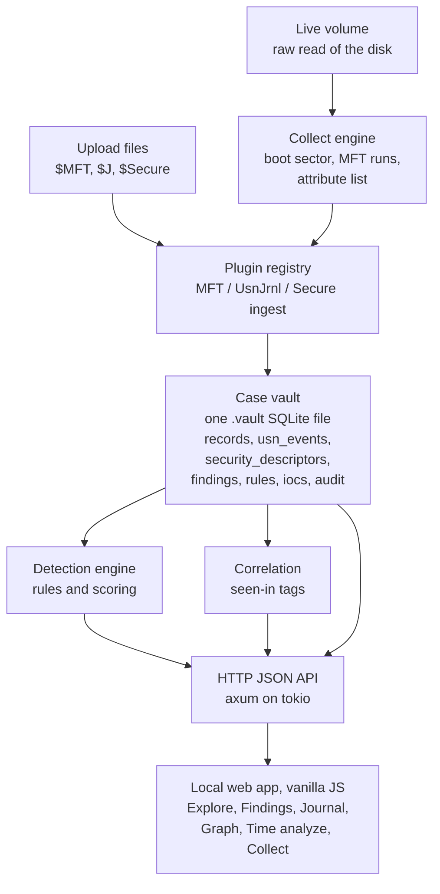
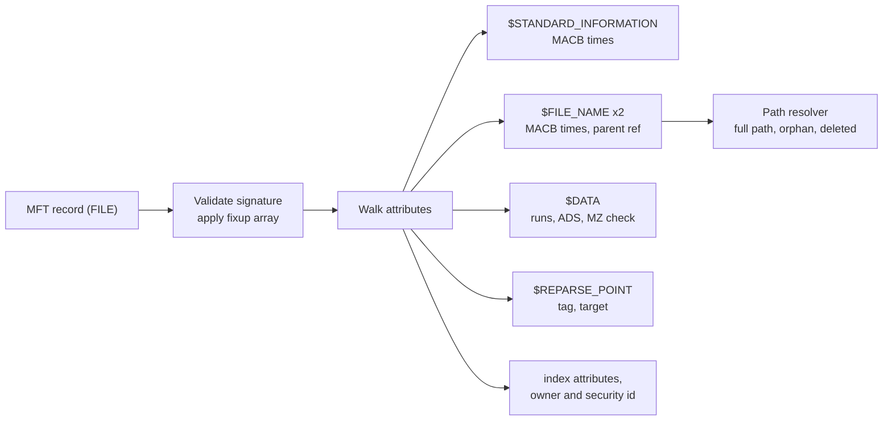
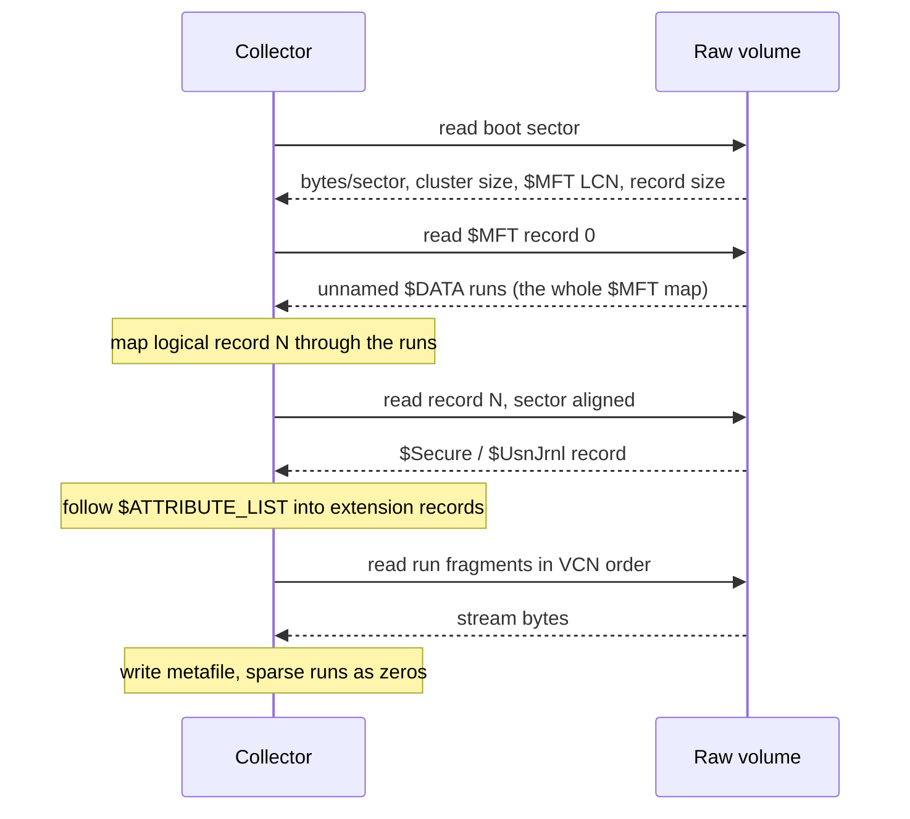
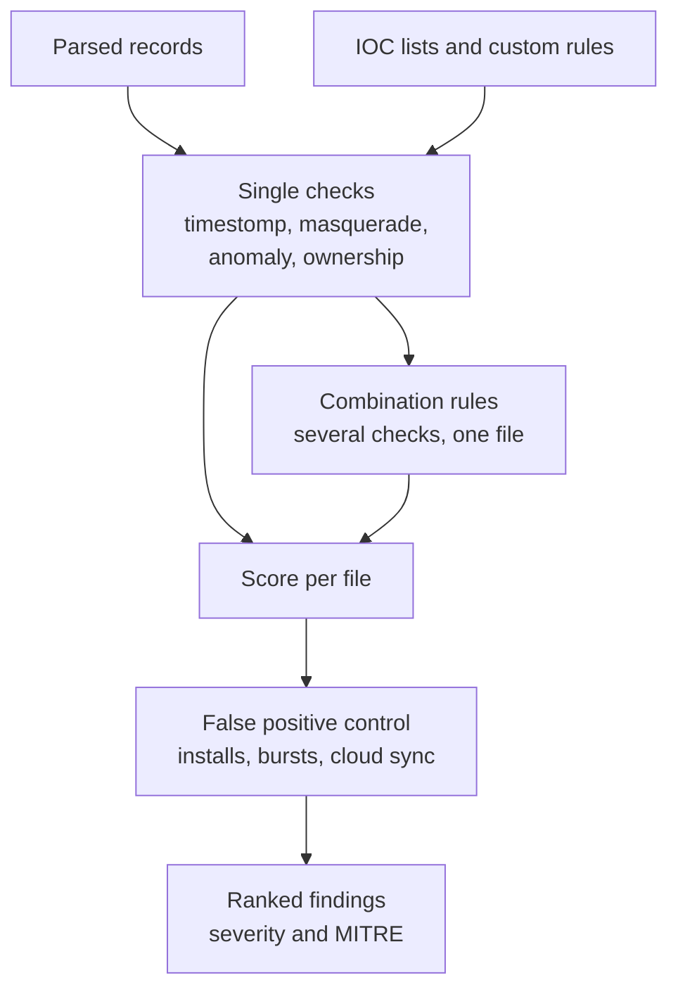
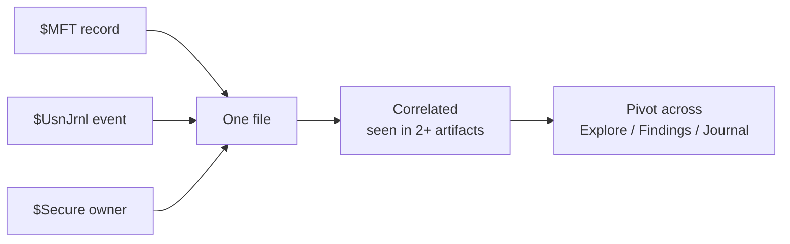
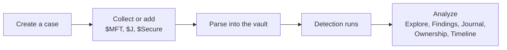

<p align="center">
  
</p>

<h1 align="center">NTFS Suite</h1>

<p align="center"><b>Collect the NTFS artifacts and analyze them.</b></p>

<p align="center">
  
  
  
  
  
  
</p>

NTFS Suite is a single binary forensic workbench for the metadata of a Windows NTFS (New Technology File System) volume. It collects the key NTFS metafiles straight off a live disk, parses them into one local case vault, rebuilds a MACB (Modified, Accessed, Changed, Born) timeline, resolves ownership, and flags timestomping and anti forensics. Everything runs offline in a local web app in your browser. No installer, no services, no cloud.

It is built for the moment in an investigation where you have a machine in front of you and need the file system history fast: what was created, what was deleted, what was renamed to look like something else, and what had its timestamps rewritten.

**Supported artifacts today:** `$MFT`, `$UsnJrnl $J` and `$Secure` (`$SDS`). You can collect all three straight off a live volume or add them as files. More artifacts (`$LogFile`, `$I30`, the Recycle Bin, and whole image carving) are on the [roadmap](#roadmap).

---

## Contents

- [Why this exists](#why-this-exists)
- [Why Rust](#why-rust)
- [How it works (architecture)](#how-it-works-architecture)
  - [The case vault](#the-case-vault)
  - [The $MFT parser](#the-mft-parser)
  - [The Collect engine](#the-collect-engine)
  - [The $UsnJrnl and $Secure parsers](#the-usnjrnl-and-secure-parsers)
  - [The detection engine](#the-detection-engine)
  - [Cross artifact correlation](#cross-artifact-correlation)
  - [The server and the web app](#the-server-and-the-web-app)
- [Features](#features)
- [Detection rules](#detection-rules)
- [Collecting artifacts](#collecting-artifacts)
- [Samples](#samples)
- [Install and build](#install-and-build)
- [Quick start](#quick-start)
- [Project layout](#project-layout)
- [Roadmap](#roadmap)
- [Contributing](#contributing)
- [Changelog](#changelog)
- [License](#license)
- [Author](#author)

---

## Why this exists

On NTFS, the truth about a file's history is not in the file, it is in the file system's own metadata. The `$MFT` records every file and its four timestamps twice over. The `$UsnJrnl` change journal logs every create, delete and rename. `$Secure` holds who owned what. Attackers know this too, which is why anti forensics targets exactly these structures: backdating a timestamp, renaming a payload to mimic a system binary, deleting a dropper after it runs.

Most of this analysis is done by stitching together separate command line parsers and spreadsheets. NTFS Suite puts the collection, parsing, timeline, ownership and detection in one place, as one portable program an analyst can carry to a host and run with nothing else installed, and it corroborates a finding across the `$MFT`, the journal and the security descriptors instead of trusting a single source.

---

## Why Rust

The choice of Rust is deliberate and shapes the whole design.

- **One portable binary.** Forensic tooling has to run on a machine you do not control, often from a USB stick on a locked down host, with no runtime to install. Rust compiles to a single native executable. Linking the C runtime statically (see [Install and build](#install-and-build)) makes it fully self contained, so it runs on a clean Windows install with no dependencies.
- **Memory safety over hostile input.** Every byte parsed here comes from on disk structures an attacker may have influenced: malformed records, bad fixups, lengths that run off the end of a buffer. Rust's bounds checking and the absence of pointer arithmetic mean a corrupt `$MFT` returns an error instead of a buffer overrun, a crash or something worse. Parsing untrusted file system metadata is exactly where memory safety earns its keep.
- **Speed on large inputs.** An `$MFT` can be hundreds of megabytes and a `$J` stream larger. The parser slices over byte buffers with no copying, and the heavy graph and ownership queries run on background threads, so the UI stays responsive while a volume is read.
- **A type system that fits the problem.** NTFS is a zoo of record and attribute variants. Enums and exhaustive matching make the parser state explicit and keep a new attribute type from being silently ignored.
- **A self contained database.** `rusqlite` with bundled SQLite gives each case a single `.vault` file with transactions and an audit log, and no external database to stand up.
- **Testable where it cannot run.** Live collection needs raw disk access and only works on Windows, but the boot sector decoding, data run mapping and stream extraction are pure functions tested against an in memory synthetic volume on any platform, so the risky code is covered by unit tests in CI.
- **Async without data races.** The local server (axum on tokio) runs parse and detection jobs in the background with progress and cancel, and Rust's ownership rules keep that concurrency safe by construction.

---

## How it works (architecture)

NTFS Suite is a Rust backend that serves a vanilla JavaScript single page app over a local HTTP server bound to localhost. There is no build step for the front end and no framework. The backend owns all parsing, storage and detection; the front end is a thin view over its JSON API.



### The case vault

Every investigation is one `.vault` file, a SQLite database created and opened through `src/vault`. It holds the parsed records, the journal events, the security descriptors, the findings, the custom rules, the imported IOC lists, and an append only audit log for chain of custody. Timestamps are always stored in UTC at full 100 nanosecond precision; the display time zone is a view setting only. The schema migrates in place, so a case made by an older version gains the new columns when it is reopened, and re parsing an evidence backfills them.

### The $MFT parser

`src/mft` reads an `$MFT` into records without assuming a layout. It detects the record size, validates the `FILE` or `BAAD` signature, applies the update sequence (fixup) array that NTFS writes across sector boundaries, and walks the attribute stream. It parses `$STANDARD_INFORMATION` (0x10) and both `$FILE_NAME` (0x30) copies for the eight MACB timestamps, the `$DATA` attribute (0x80) including named alternate data streams and whether a resident stream begins with an `MZ` executable header, the reparse point (0xC0) tag and target, index attributes, the hard link count, the DOS 8.3 short name, and the owner and security ids. A path resolver turns parent references into full paths and marks orphan and deleted records where the parent is gone or the sequence number does not match.



### The Collect engine

This is the heart of v0.8 and the most involved piece. `src/collect` acquires the NTFS metafiles directly from a live volume with no external imager, which means reading the raw disk, so it runs on Windows as Administrator.

How a collect works, end to end:

1. **Open the raw volume.** `\\.\C:` is opened with sector aligned reads. All volume I/O goes through a `BlockReader` trait, so the logic above it is pure and testable.
2. **Parse the boot sector.** Bytes per sector, sectors per cluster (including the power of two encoding used for large clusters), the `$MFT` logical cluster number, and the MFT record size (including the negative i8 encoding) are read from the BIOS parameter block.
3. **Bootstrap the $MFT.** Record 0 is the `$MFT` describing itself. Its unnamed `$DATA` runs are parsed to learn where every MFT record physically lives.
4. **Read any record on demand.** A logical record number is mapped through the `$MFT` data runs to a physical byte offset, so record N can be read without loading the whole table.
5. **Follow the attribute list.** On a large volume a stream such as `$Secure:$SDS` or `$UsnJrnl:$J` does not fit in one base record; its attributes spill into extension records through an `$ATTRIBUTE_LIST`. The engine detects this, follows the list into the extension records, and reassembles the fragments in VCN order.
6. **Stream the metafiles out.** `$MFT`, `$Secure:$SDS` and `$UsnJrnl:$J` (located under `$Extend`) are streamed to disk, materialising sparse runs as zeros so stream offsets stay aligned for the parsers.



The result can go to a folder, or straight into a new case or your current case that is collected, parsed and opened ready to analyze. The boot sector decoders, the run mapping, the sparse extraction and the attribute list walking are all covered by unit tests over an in memory synthetic volume.

### The $UsnJrnl and $Secure parsers

`src/usn` scans the sparse `$J` change journal stream, skipping the sparse and padding gaps, and decodes both V2 and V3 USN records into their reason flags (create, delete, rename, data overwrite, security change and the rest) with a one word summary per event.

`src/secure` reads the `$SDS` security descriptors, de duplicates the mirror copy NTFS keeps, decodes the owner and group SID to the `S-1-...` form, resolves the common well known SIDs to names offline, and counts the allow and deny ACEs of the DACL. Each record's security id then resolves to a real account on the Ownership tab and in every record popup.

### The detection engine

`src/detection` runs a catalog of rules over the parsed records and scores each file by the sum of what fired, because one indicator alone is never proof. Single checks run per record; combination rules fire only when several single checks land on the same file, which is the stronger signal. Every rule carries a severity and a MITRE ATT&CK technique, and false positive noise (install caches, bulk creation seconds, cloud sync folders) is discounted. Analysts can disable any built in rule per case, write their own in a declarative builder (boolean condition trees over record fields, evaluated offline with no code execution), and import IOC lists of names, paths, sizes and hashes.



### Cross artifact correlation

A single file can appear in the `$MFT`, the `$UsnJrnl` and `$Secure`. The backend tags each row with the artifacts that mention it (a "seen in" set), raises a correlated flag when two or more agree, and lets you pivot between Explore, Findings and the Journal for the same file, so a finding is corroborated across sources rather than read from one.



### The server and the web app

`src/server` serves the app and the JSON API on localhost and runs parse and detection as background jobs with live progress and cancel. In a release build the whole web app is embedded in the binary; in development it is served from the `assets` folder so edits show on reload. The front end (`assets`) is plain HTML, CSS and ES module JavaScript: a small router, one page module per view, a shared theme in `root.css`, and no external runtime.

---

## Features

- Collect `$MFT`, `$UsnJrnl $J` and `$Secure` straight off a live Windows volume with the Collect button, into a folder or straight into a parsed case (run as Administrator), with no external imager.
- Parse an `$MFT` into records at full 100 nanosecond precision, reading both `$SI` and `$FN` timestamps, alternate data streams, reparse points, hard links, owner and security ids, and rebuilding full paths with orphan and deleted records marked.
- Keep each case in one `.vault` SQLite file with an audit log for chain of custody.
- Explore records in a filtered, paged, searchable table with a column chooser and saved views per case, and copy the current view as CSV or JSON.
- Read the `$UsnJrnl $J` change journal on a dedicated Journal page, with an executable created then deleted flagged.
- Add a `$Secure` to resolve the Ownership ids to real account names, shown on the Ownership tab and in every record popup.
- See which artifacts mention each file, with a correlated tag and jumps between Explore, Findings and the Journal.
- Run detection automatically after a parse and re run it on demand, then read ranked findings with MITRE mapping, finding status and folder grouping.
- Write and preview your own detection rules, disable built in ones, and import an IOC list, all per case.
- Build a MACB timeline on the Time analyze tab, and read a Sleuth Kit bodyfile back in (from this tool or another examiner) as the same timeline.
- Read the Graph page as two tabs: the NTFS metadata map and ownership by id.
- Control the display time zone (every IANA zone), with stored values always in UTC.
- Open any view by a long, shareable address such as `/case/<case-name>-<case-number>/findings`.

---

## Detection rules

Findings are ranked by total score per file, because one check alone is never proof. The Rules tab in the app shows this same catalog, lets you disable any built in rule, and lists what each one needs.

### Timestomp and anti-forensics

| Rule | Title | Severity | MITRE | Checks |
| --- | --- | --- | --- | --- |
| MFT-TS-01 | Standard Information created before File Name created | medium to high | T1070.006 | $SI creation earlier than $FN creation by more than a few seconds; install caches and bulk seconds discounted; a zeroed sub second, a time before the volume, a future time or a risky executable raise it to high; gap size ranks it |
| MFT-TS-02 | Standard Information sub seconds all zero | high | T1070.006 | all seven $SI creation sub second digits zero while $FN keeps precision |
| MFT-TS-03 | Standard Information created before the volume | medium | T1070.006 | $SI creation earlier than the volume creation |
| MFT-TS-05 | Standard Information creation zeroed to 1601 | medium | T1070.006 | $SI creation set to the 1601 zero value |
| MFT-TS-06 | Standard Information creation in the future | medium | T1070.006 | $SI creation later than the analysis time |
| MFT-TS-07 | File Name created before Standard Information created | low | T1070.006 | the FN<SI direction; the FN copy is normally set at creation, so this gap means a creation time was changed |
| MFT-AF-01 | Alternate data stream present | low to medium | T1564.004 | a named data stream is attached; heavier for executable content and streams outside Downloads |
| MFT-AF-03 | Orphan record | low | T1070.004 | parent gone or sequence mismatch, so the path cannot be trusted |
| MFT-AF-04 | Known wiper trace | high | T1070 | name matches cipher, BCWipe or SDelete leftovers |

### Masquerading and anomalies

| Rule | Title | Severity | MITRE | Checks |
| --- | --- | --- | --- | --- |
| MFT-AN-01 | Executable in an unusual location | medium | T1036.005 | code in a temporary, recycle or drive root folder |
| MFT-AN-02 | Archive in an unusual location | low | T1036.005 | archive in a temporary or root folder, possible staging |
| MFT-AN-03 | Modified time older than creation time | medium | T1570 | copied in from another volume or the network; creation is the copy time |
| MFT-AN-04 | Creation burst | low | T1036.005 | many files share one creation second |
| MFT-AN-05 | Look alike system name | high | T1036.005 | a name imitating a Windows process, misspelled or not on modern Windows |
| MFT-AN-06 | Known file from an unknown path | high | T1036.005 | a known system file or DLL name running from a path that is not one of its homes |
| MFT-AN-07 | Name abuse | high | T1036.002 | a right to left override, a trailing dot or space, or a double extension |
| MFT-AN-08 | Short name does not match the long name | low | T1036 | the 8.3 short name does not derive from the long name |
| MFT-AN-10 | Executable content resident in the MFT | medium | T1564.004 | a resident data stream starting with the MZ header, code with no file on disk |
| MFT-AN-11 | MFT slot reused | low | T1070.004 | an in use record with a sequence above one, so the slot held earlier deleted files |
| MFT-AN-12 | Hidden and system executable | medium | T1564.001 | an executable with both hidden and system set in a user writable folder |
| MFT-RP-01 | Risky reparse point | medium | T1574 | a junction or symlink in a user writable folder pointing into a system path |
| MFT-OWN-01 | System binary owned by a non-system account | high | T1222 | a system-folder executable whose owner, resolved through $Secure, is not SYSTEM, TrustedInstaller or Administrators (needs a $Secure) |

### Combination rules (fire on the same file)

| Rule | Title | Severity | MITRE | Fires when |
| --- | --- | --- | --- | --- |
| MFT-C1 | Timestomped file, high confidence | high | T1070.006 | MFT-TS-01 and MFT-TS-02 |
| MFT-C2 | Masqueraded and hidden binary | high | T1036.005 | MFT-AN-06 and MFT-AN-12 |
| MFT-C3 | Masqueraded and timestomped | high | T1036.005 | MFT-AN-06 and MFT-TS-02 |

### Your own rules and IOC lists

The Rules tab has a builder for custom rules: a title, a severity, an optional MITRE id and reason, and a condition tree of all / any / not groups over leaf tests (field, operator, value) against each record's parsed fields. The engine runs offline with no code execution and bounded regular expressions. Preview a rule over the current evidence before saving it to the case, where it runs alongside the built in rules on every detection. An IOC list imported as JSON or CSV (name, path, size, hash) is matched by rule **MFT-IOC-01**.

---

## Collecting artifacts

The built in Collect engine is the primary way to acquire the artifacts: open Collect from the top bar, pick a volume, choose a full collect or a subset (`$MFT`, `$UsnJrnl $J`, `$Secure $SDS`), and send the result to a folder, a new case, or your current case. Live reads need the app to run as Administrator and are Windows only.

If you already have the artifacts from a disk image, a mounted read only volume, or a triage tool (KAPE, Velociraptor, FTK Imager), add them from the Add evidence page. Always keep the matching `$MFT` with any journal, because the journal stores file references that only the `$MFT` can turn back into full paths.

---

## Samples

The Samples page in the app lists public sample cases to practice on. It reads `assets/samples-index.json`, which names each case and its files and points at copies in the `samples/` folder of the repository, so the links stay correct and the app never downloads anything for you.

The goal for the sample library is a case per anti forensics technique: each case carrying a real NTFS artifact set that reproduces one specific trick, so you can load it, see how the technique looks in the metadata, and watch which detection rule catches it. For example a case that only timestomps `$SI` creation, another that renames a payload to masquerade as a system binary, another that deletes a dropper and leaves the trace in the `$UsnJrnl`, and so on across the catalog. Built this way the samples double as a hands on map of how each attack writes itself into NTFS.

**This is one of the best ways to contribute.** If you can build NTFS cases that demonstrate anti forensics techniques (a crafted `$MFT`, a `$UsnJrnl $J`, a `$Secure`, or a small volume image that reproduces one), I would love to add them to the sample library with credit. See [Contributing](#contributing).

---

## Install and build

Needs the Rust toolchain from https://rustup.rs.

```
cargo build --release
cargo test
```

The optimized binary is written to `target/release/ntfssuite` (`ntfssuite.exe` on Windows). Run it and it opens the local web app in your browser. In development, `cargo run` serves the front end from the `assets` folder so edits show on reload.

**A fully portable Windows exe.** To make the exe run on a clean Windows install with no Visual C++ redistributable, link the C runtime statically. Create `.cargo/config.toml`:

```toml
[target.x86_64-pc-windows-msvc]
rustflags = ["-C", "target-feature=+crt-static"]
```

Then `cargo build --release` produces a self contained 64 bit exe that runs on any current Windows PC or laptop.

---

## Quick start



1. Launch the app. The browser opens to the local web app.
2. First run asks for an analyst name and a cases folder.
3. Create a case from the Cases panel.
4. Collect, or add evidence: open Collect (as Administrator) to pull the artifacts off a live volume into the case, or add a saved `$MFT`, `$UsnJrnl $J` or `$Secure` from Add evidence.
5. The artifacts parse, detection runs, and the case opens.
6. Work the case: Explore the records, read ranked Findings, follow the Journal, resolve Ownership on the Graph page, and build a timeline on Time analyze.

---

## Project layout

- `src/mft` the NTFS parser: header, fixup, attributes (including the reparse point attribute), data runs, path resolver.
- `src/usn` the `$UsnJrnl $J` change journal parser: USN record scanning over the sparse stream, reason decoding.
- `src/secure` the `$Secure` parser: `$SDS` descriptors, SID decoding and well known SID names.
- `src/collect` the live volume Collect engine: boot sector parsing, a block reader over the raw volume, `$MFT` data run mapping to read any record, attribute list following, and extraction of `$MFT`, `$UsnJrnl $J` and `$Secure $SDS`. `volume.rs` enumerates NTFS volumes and opens `\\.\X:` with sector aligned reads (Windows only at runtime).
- `src/vault` the case vault: schema, migrations, and the case, evidence, record, finding, rule, IOC, USN event and security descriptor stores, plus the audit log.
- `src/detection` the detection engine, scoring, MITRE map, the timestomp, anti forensics, anomaly, ownership and NTFS IOC rules, the known location map for masquerading, the rule catalog, and the declarative rule engine.
- `src/plugins` the plugin trait, registry, and the MFT, UsnJrnl and Secure plugins.
- `src/server` the local server, security guard, asset serving and background jobs.
- `src/api` the HTTP handlers for cases, evidence, records, findings, rules, IOC lists, graph (anatomy, ownership), the USN journal, live collection and export.
- `src/settings` first run setup and the settings model.
- `src/util` FILETIME, clock and byte readers.
- `assets` the web app: HTML, CSS and JavaScript modules, the icons and the samples index.
- `samples` the sample case files linked from the Samples page.
- `scripts` helper scripts, including the samples index check.
- `tests` unit tests with a synthetic MFT record builder.

---

## Roadmap

Built in versions. Each shipped version is a full working tool, released before the next starts.

- [x] **v0.1** Parser, vault and server
- [x] **v0.2** Explore and time zones
- [x] **v0.3** Detection and findings
- [x] **v0.4** Graphs (statistical dashboard, later set aside for the link graph)
- [x] **v0.5** Graph (NTFS metadata anatomy map)
- [x] **v0.6** Guide, samples, exports and report
- [x] **v0.7** Usability, custom rules, extended parser and link analysis
- [x] **v0.8** Journals and security (`$UsnJrnl`, `$Secure`), cross artifact correlation, and the live Collect engine  _(current)_
- [ ] **v0.9** Recovery and carving  _(in development)_ : whole image ingestion (raw or E01), recovering deleted files, and carving from unallocated space.
- [ ] **v1.0** First complete release  _(planned)_ : the full artifact set, execution evidence in the graph, and a hardened release.

See the [Changelog](#changelog) for the detail of each shipped version.

---

## Contributing

NTFS Suite is open source and contributions are welcome: parsers for more artifacts, detection rules, UI work, documentation, test coverage, or sample cases. Bug reports and ideas are just as useful as code.

A standing ask: **anti forensics sample cases.** I want the [sample library](#samples) to cover every anti forensics technique, one case each, with a real NTFS artifact set that reproduces the trick. If you can craft cases like that (timestomping, masquerading, journal tampering, stream abuse, ownership changes, and more), get in touch and I will add them with credit.

To get involved, email **[qayssarayra.h@gmail.com](mailto:qayssarayra.h@gmail.com?subject=contribute%20with%20NTFS%20Suite)** with the subject **`contribute with NTFS Suite`**. Tell me what you want to work on and we will take it from there.

---

## Changelog

- **v0.8 Journals and security:** two new upload types join `$MFT`, recognised by their contents or their name, one of each per case. A `$UsnJrnl $J` is parsed into its change events and shown on a new Journal page (route `/journal`) with per change tiles, a name search, a change type filter and a date range; entries created then deleted as an executable, or renamed to an executable, are flagged. A `$Secure` is parsed into its `$SDS` security descriptors, decoding each security id to an owner SID, group SID, a resolved well known name, and the allow and deny counts of its DACL; the Ownership tab then shows the owner name beside each security id. Detection gains MFT-OWN-01, a system folder executable owned by a non system account, which fires once `$Secure` is present. New parser modules `src/usn` and `src/secure`, new stores for journal events and security descriptors, and new plugins for both artifacts.
- **v0.8 Collect engine:** a Collect button beside Cases acquires NTFS metafiles from a live Windows volume without an external imager. The panel lists readable NTFS volumes, lets you pick a full collect or a subset, and sends the result to a chosen folder, a new case, or the current case, created, parsed and opened ready to use. The engine parses the boot sector, reads `$MFT` record 0 to learn the `$MFT` layout, maps logical record offsets through the `$MFT` data runs, follows the `$ATTRIBUTE_LIST` into extension records for split streams, locates `$UsnJrnl` under `$Extend`, and streams each metafile to disk. New module `src/collect`, new API `GET /api/collect/volumes` and `POST /api/collect/run`, and a Collect side panel. Raw reads are Windows only and need Administrator; the parsing and run mapping logic is covered by unit tests over an in memory synthetic volume.
- **v0.8 Correlation:** each record is tagged with the artifacts that mention it, a correlated flag is raised when two or more agree, and Explore, Findings and the Journal cross navigate for the same file.
- **v0.7 Ownership and extended parser:** the Graph page is tabbed (NTFS map and Ownership by id). The `$MFT` parser now reads the reparse point tag and target, the hard link count, the owner and security ids, the USN, the real data size, the DOS 8.3 short name, and whether a resident `$DATA` stream holds an executable; the vault schema adds these columns and upgrades existing cases in place. New rules use the new fields: name abuse (MFT-AN-07), short name mismatch (MFT-AN-08), resident executable (MFT-AN-10), MFT slot reuse (MFT-AN-11), hidden and system executable (MFT-AN-12), risky reparse point (MFT-RP-01), the FN<SI direction (MFT-TS-07), three combination rules (MFT-C1/C2/C3), and an IOC list match (MFT-IOC-01).
- **v0.7 Rules, masquerading and usability:** a declarative rule engine and builder (offline boolean conditions over record fields, with a live preview), a masquerading rule (MFT-AN-06) from an offline editable map of known system file homes, a scored SI<FN timestomp rule with tolerance and corroboration, one evidence of each type per case with cascade delete, a command palette (Ctrl K), a dark/light theme toggle, CSV/JSON copy with a column chooser and saved views, right side panels, and long bookmarkable routes.
- **v0.6 Guide, samples, exports and report:** an offline in app Guide, a printable HTML findings report and a JSON report, a Sleuth Kit bodyfile and timeline CSV export, a bodyfile reader on Time analyze, and a Samples page driven by `assets/samples-index.json`.
- **v0.5 Graph:** the Graph tab shows an NTFS anatomy of the volume's metadata files with their roles and live facts from the parsed evidence, with zoom, pan and reset.
- **v0.4 Graphs:** a case dashboard of SVG charts with a brushable activity timeline, later set aside in favor of the link graph and the anatomy map.
- **v0.3 Detection and findings:** timestomp, anti forensics and anomaly checks, scoring and per file ranking, MITRE mapping, finding status, cloud sync downgrade, detection after parse and on demand, and a Findings page.
- **v0.2 Explore and time zones:** case and evidence flow, parse with progress and cancel, a record table with filters, search and paging, time zone control, and record and timeline export.
- **v0.1 Parser, vault and server:** the `$MFT` parser core, the case vault, the plugin registry, the local server with the security rules, first run setup, and the web app shell.

---

## License

Released under the MIT License. You are free to use, modify and distribute it, including in commercial work, as long as the copyright notice is kept. See [LICENSE](LICENSE) for the full text.

---

## Author

Built by Qays Sarayra. [qayssarayra.com](https://qayssarayra.com)
